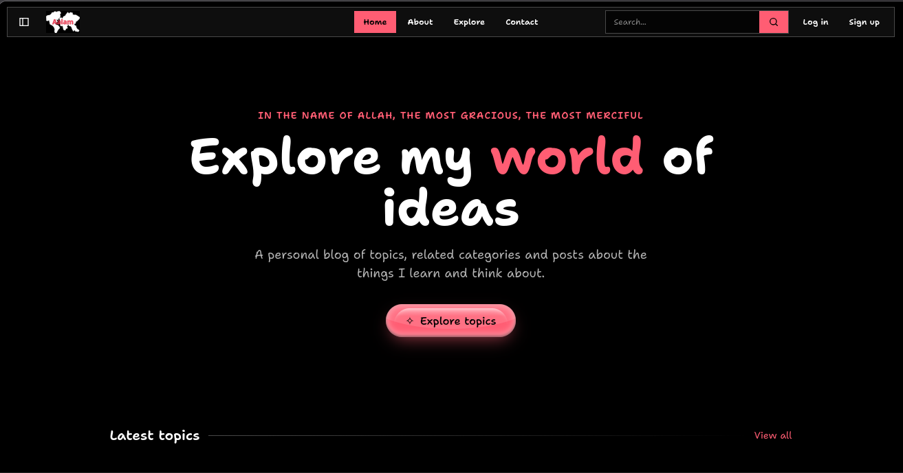
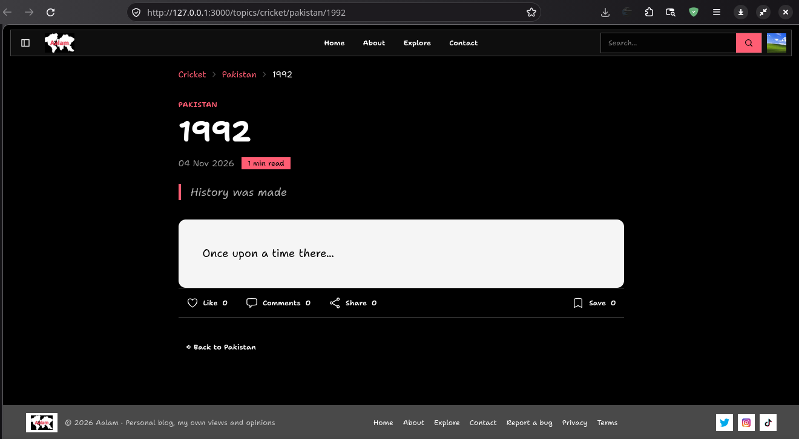
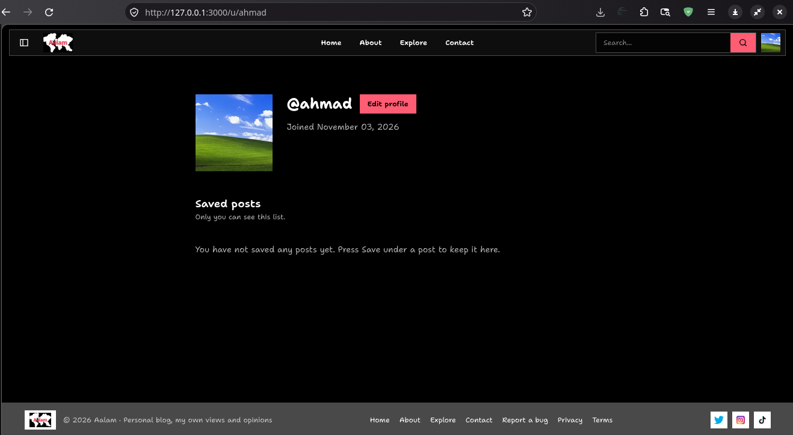
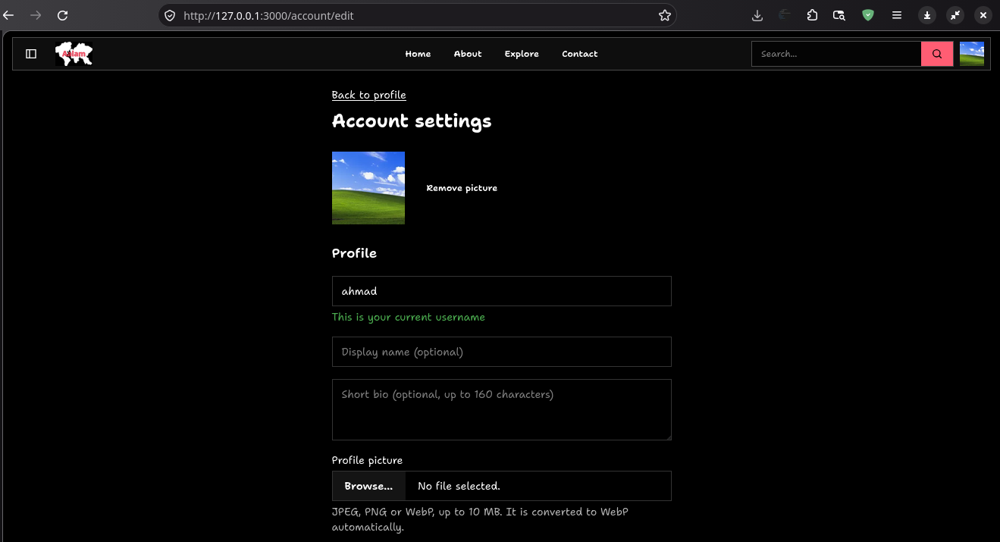

# Aalam

A personal blog built with Rails 8. Readers can browse posts by topic and card, and signed-in readers can like, save, comment, reply and share. An admin area manages topics, cards and posts.


<table>
  <tr>
    <td></td>
    <td></td>
  </tr>
  <tr>
    <td></td>
    <td></td>
  </tr>
</table>

## Features

**Blog**
- Topics, sub categories and posts with Markdown rendering, search, and slugs that keep old URLs working with a redirect

**Accounts**
- Sign up with username and email. Log in with either username or email
- Log in with GitHub or Google
- Email verification with a 6 digit code
- Delete your own account

**Engagement**
- Like, save, Comments and share posts
- Unverified users cannot like, save or comment

**Other**
- Contact form that emails the site owner (messages are not stored)
- Privacy Policy and Terms of Use pages
- Strict Content Security Policy

## Stack

- Ruby 4.0.6, Rails 8.1.4
- PostgreSQL
- Hotwire (Turbo and Stimulus)
- Tailwind CSS v4 and daisyUI, Propshaft
- Solid Queue and Solid Cache
- Active Storage (local disk in development, Cloudflare R2 in production)
- Lenis and GSAP for scrolling and animation
- Minitest and Capybara for tests

## Getting started

You need [mise](https://mise.jdx.dev) (or another way to install Ruby 4.0.6) and a running PostgreSQL server.

```bash
git clone git@github.com:ahmxad/Aalam.git
cd Aalam
mise install
bin/setup
```

`bin/setup` installs the gems, creates the database, and starts the development server. Later, start the server with `bin/dev`. Then open http://127.0.0.1:3000.

Emails in development are not sent. Open http://127.0.0.1:3000/letter_opener to read them, for example the verification codes.

## Tests

```bash
bin/rails test          # unit, controller and integration tests
bin/rails test:system   # browser tests (needs Chrome)
```

## Production

The app ships with a `Dockerfile` and a Kamal configuration. Production settings come from the credentials, so nothing is hard coded:

- `site`: `host`, `contact_email`, `mail_from`
- `smtp`: `address`, `port`, `user_name`, `password`
- `r2`: `account_id`, `access_key_id`, `secret_access_key`, `bucket` (uploads go to the local disk when these are not set)

Background jobs run inside Puma when `SOLID_QUEUE_IN_PUMA` is set, which suits a single small server.


> It's ready to go live but the hosting is too much expensive man.